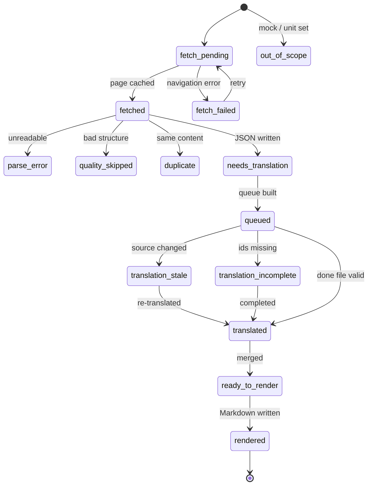

# AUZEF Çocuk Gelişimi — bilingual exam corpus

Past exams from `lolonolo.com/auzef/cocukgelisimi/`, Turkish original plus
Modern Standard Arabic translation, in a form meant to be consumed by an
offline quiz app.

## Layout

```
output/
  <course-slug>/<exam-slug>.md     rendered exam (one file per exam)
  .cache/json/<course>__<exam>.json canonical source of truth
  .cache/html/<sha1>.html          raw settled pages
  manifest.json                    index + hashes + skipped records
  glossary.json                    mandatory TR→AR terminology
  assets/                          images/tables (only when a page has them)
  logs/                            fetch, retry and error logs
```

Markdown is generated from the JSON; the JSON is canonical. Turkish fields in
the JSON are exactly what the page contained (whitespace-normalised only).

## Exam file format

```markdown
---
course: ANNE BABA EĞİTİMİ
exam: 2024-2025 Bütünleme Soruları
source_url: https://lolonolo.com/...
question_count: 20
scraped_at: 2026-11-11T23:01:22+03:00
---

### Q1
**Question:** <Turkish> | <Arabic>
**Choices:**
- A) <Turkish> — <Arabic>
- B) ...
**Answer:** E
```

Rules enforced by `scripts/validate.py`:

- questions numbered sequentially from 1, count matches front matter and JSON;
- 4–5 choices, letters sequential from A;
- Turkish equals the canonical JSON byte-for-byte after reversing `<br>`;
- Arabic is Arabic script (Latin glosses only inside parentheses/acronyms);
- answer is a valid choice letter, or `UNKNOWN`;
- no duplicate exam content;
- manifest entries marked `done` have a file and are fully translated.

Multi-line stems keep one logical line by encoding line breaks as `<br>`.
Uncertain translations carry an inline comment:
`<!-- REVIEW: q7.stem: reason -->`.

Site chrome that some legacy pages inject into the article body (ad-controller
strings such as “No ad requested because of display:none on the adsbygoogle
tag”, or a bare `lolonolo` watermark line) is not exam text and is dropped
during parsing.

Three page shapes are handled by the legacy parser:

1. numbered questions (`1.`, `1)`, `1-`) — plain text pages;
2. numbered questions whose wording repeats the correct option instead of
   writing `Cevap : C)` — accepted only on an exact option-text match;
3. unnumbered questions, each followed by `A)`–`E)` and a `Cevap :` line —
   parsed by splitting on the answer lines.

A page that has no options at all (answers only) cannot be reconstructed and is
recorded as `skipped_quality` / `no_questions`. A page titled “Vize Ve Final
Soruları” with no term is a unit-by-unit study compilation, not a sitting of an
exam, and is recorded as `skipped_quality` / `compilation`. The same applies to
a term-less “Vize/Final Soruları” page whose body interleaves true/false items
(`Doğru` / `Yanlış` / `Cevap : …`), unit headings and dash separators inside one
question: it is a question bank, not an exam. A shared course page can also list
another programme's exams (`Anatomi (TDS)`); those are recorded as
`skipped_quality` / `other_programme`.

## Fields in `manifest.json`

- `answer_source`: `markup` (answer encoded in the quiz plugin's option values),
  `inline` (legacy page states `Cevap : C)`), or `none`.
- `omitted_questions`: questions dropped from a page whose own markup was
  defective. `reason` is `choice_count` (not 4–5 options), `option_letters`
  (a letter is missing because the page collapsed two options onto one line),
  or `short_stem`. The rest of the exam is kept and renumbered.
- `skipped[]`: every exam deliberately not included, with `status`:
  `out_of_scope` (mock “deneme” / unit “ünite” sets), `skipped_quality`
  (structurally unusable page), `duplicate_content`, `fetch_missing`.
  Duplicate detection compares question content, not order. A page that
  republishes the same questions and options with everything shuffled is
  marked `duplicate_content` with `quality_reason: same_questions_as:…`.
- `content_hash` / `file_hash`: content identity and the rendered file digest.
- `source_numbers` (JSON only): the page's own question numbers when they did
  not run 1..n (a skipped number, or a label repeated out of order such as 13
  in place of 36). Questions keep their page order and are renumbered 1..n.
  Pages that repeat the correct option instead of writing `Cevap : C)` are read
  as that option, but only on an exact match with an option already listed.
- `state` / `translation_state` / `next_action`: the pipeline lifecycle (below).
- `pipeline`: corpus-wide totals copied from the same state snapshot.
- `state` also appears on `skipped[]` records (`out_of_scope`,
  `quality_skipped`, `fetch_missing`, …) so every page has exactly one state.

## Pipeline state machine

Every artifact used to imply its own status (file present? config status? hash
match?). `scripts/state.py` now derives **one** state per exam from what is
actually on disk, read-only. `scripts/status.py` is a thin alias for it.



`next_action` is the single next command: `fetch`, `retry_fetch`, `parse`,
`translate`, `fix_translation`, `merge`, `render`, `review`, or `none`.

Two derived checks matter beyond the exam state:

- **render freshness** — `rendered` means the Markdown is byte-identical to
  `render_md.render(json)`, not merely present. A JSON that was re-merged
  without re-rendering shows as `ready_to_render` with a `markdown_stale`
  warning.
- **course roll-up** — each course gets `state` (`fetching`, `parsing`,
  `translating`, `merging`, `rendering`, `review`, `complete`, `page_pending`,
  `page_cached`) and a single `next_action`, chosen in blocking order. That
  replaces the ambiguous “review 3” next to an otherwise finished course.

`scripts/next_batches.py` reads the same model, so a stale or incomplete done
file is retried instead of being mistaken for a finished exam.

```bash
/usr/bin/python3 scripts/state.py             # course table + counts
/usr/bin/python3 scripts/state.py --exams     # one row per exam
/usr/bin/python3 scripts/state.py --json      # stable snapshot (schema pipeline_state/v1)
/usr/bin/python3 scripts/state.py --check     # exit 1 on contradictory artifacts
/usr/bin/python3 scripts/state.py --diagram   # Mermaid source
/usr/bin/python3 scripts/next_batches.py      # translation work, from the same model
/usr/bin/python3 scripts/failed_fetch.py      # URLs whose last fetch failed (retry list)
```

## Scope

Phase 1: nine named child-development courses, 136 real past exams
(vize / final / bütünleme). Mock and unit sets are recorded as out of scope.

Phase 2 extends the same pipeline to the remaining courses on the programme
index:

```bash
# 1. fetch the 45 course index pages (they are not exam pages yet)
/usr/bin/python3 scripts/fetch_many.py --file config/fetch_p2_courses.txt \
    --until commit --block media,image,font
# 2. read exam links from the cached pages
/usr/bin/python3 scripts/discover_courses.py
# 3. append them to the single canonical config
/usr/bin/python3 scripts/merge_p2.py
# 4. then the normal cycle
/usr/bin/python3 scripts/fetch_many.py --file config/fetch_p2.txt --until commit --block media,image,font
/usr/bin/python3 scripts/advance.py
```

`--until commit` plus `--block media,image,font` exists because the CDP proxy
caps navigation at 30 s and some posts embed autoplaying video. The article
HTML is server-rendered, so blocking media loses nothing.

For large batches use the watchdog driver instead of one long browser session;
a wedged CDP navigation otherwise stalls the whole queue:

```bash
/usr/bin/python3 scripts/fetch_batch.py config/fetch_p2.txt --cap 75
```

It runs one fetch per subprocess (one at a time), skips cached pages, and caps
each URL at 75 s.
